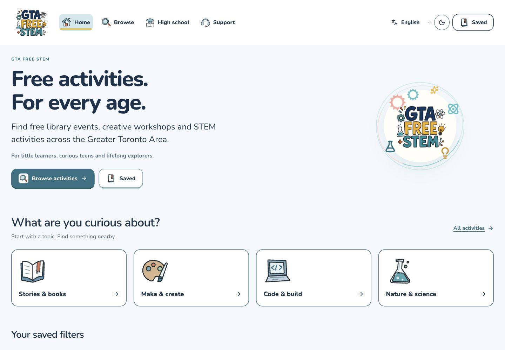
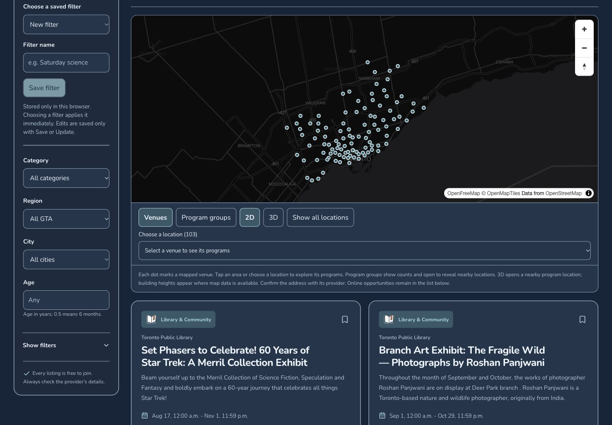

# GTA FREE STEM

Find free library events, creative workshops and STEM activities across the Greater Toronto Area—for babies, children, teens, parents and adults. Browse without creating an account.

This repository contains the public website, search tools and source collectors. It also publishes the opportunity feed used by the separate iOS and Android apps.

[Open the website](https://gta-free-stem.pages.dev/) | [iOS app](https://github.com/rupayon123/gta-free-stem-ios) | [Android app](https://github.com/rupayon123/gta-free-stem-android)

## The web experience

The October 29 website refresh uses the approved cool light/dark canvas, Nunito and original GTA role artwork. Home offers topics and local saved-filter shortcuts; Browse keeps the citywide map and search. The screenshots below show the actual production export; their source and verification scope are recorded in the capture receipt.

<table>
<tr><th width="50%">Home — light</th><th width="50%">Browse — dark</th></tr>
<tr><td align="center"><a href="docs/showcase/2026-10-29-ios-v3-web/desktop-home-light.png"></a></td><td align="center"><a href="docs/showcase/2026-10-29-ios-v3-web/desktop-browse-dark.png"></a></td></tr>
</table>

[Capture provenance and checks](docs/showcase/2026-10-29-ios-v3-web/README.md). Earlier public captures remain dated history: [October 29 city-map release](docs/showcase/2026-10-29-city-map-live/README.md) and [October 27 site](docs/showcase/README.md). Result counts change with accepted source refreshes.

## What you can do

- Search by activity, topic, library or city, including common spelling mistakes.
- Narrow the results with visible city, age and category filters.
- Explore locations on the map, switch between 2D and 3D neighbourhood views, or choose List to scan activities.
- Open schedules, age ranges, accessibility information when provided, and original registration links.
- Read the provider’s complete original description on a GTA event page, with a link back to the provider for updates.
- Save activities in the current browser without signing in.
- Save named filters for different interests or ages. Selecting applies them immediately; Save/Update is explicit. Filters remain local to this browser, with no automatic alerts or unread-result badges.

## Find an activity

1. On the [home page](https://gta-free-stem.pages.dev/), choose a topic or **Browse activities**. Home also links to filters you have saved in this browser.
2. The [opportunity directory](https://gta-free-stem.pages.dev/opportunities/) opens in **Map** view. Every mapped venue appears as a dot. Tap an area or use **Choose a location** to explore its activities; **Program groups** shows the counts. Choose **List** beside Map to scan activities. Both views use the same search and filters; switching views keeps your choices. Choose **3D** to explore a nearby program location with real building heights where map data is available; **2D** flattens the view and **Show all locations** returns to the flat venue overview. Online activities remain available in List.
3. Refine by city, age, category or the additional filters. Clear filters to return to the broader list.
4. Open a result to check its schedule, age range, location, provider, and original source. Select **Read full description** for the complete original text on the GTA event page. Follow the provider's link to confirm availability and register when required.
5. In Filters, name and **Save filter** to retain your criteria. Choose an existing saved filter to apply it immediately; edits require **Update filter**. **Clear filters** resets the current search without deleting saved filters. **Delete filter** removes only the selected record. Home links back to filters saved in the same browser.
6. Use the bookmark control to save an activity for later on this browser. Saved items are local to the current browser and website address; no account is needed for browsing.

The [High School guide](https://gta-free-stem.pages.dev/high-school/) separates volunteering, learning, leadership and careers, and scholarships and support. Choose age and grade independently, review provider requirements, or record actual volunteer minutes in a local hours notebook and export a personal CSV. **Teen activities** keeps the existing activity search. The first reviewed collection has no confirmed individual volunteer roles: directories and programme intakes are labelled separately, and school approval is never automatic. Listing summaries may be generated for browsing. Complete original descriptions are available from each result; check the provider for current details and availability. [See the full-description screenshots](docs/showcase/README.md#full-original-descriptions).

## About the site

The colourful GTA logo and orbiting science icons carry the app’s visual identity onto the website. Click or tap the logo to pause or resume its orbit, with a brief playful jiggle. Icons stay upright as they travel. The same action works from the keyboard, and motion respects reduced-motion preferences. Search and filters remain usable without waiting for an opening animation.

The interface offers 18 language choices. Provider descriptions are not fully translated into every language; use the original provider page for authoritative details. Anonymous saves stay in the current browser and do not transfer automatically between website addresses.

The site uses Next.js and TypeScript, with MapLibre and OpenFreeMap for maps. It builds as a static export.

## Run locally

```bash
npm ci
npm run dev
```

To check and build the site:

```bash
npm run typecheck
npm run qa
npm run build
```

The free static publication is written to `out/` by `npm run build:github-pages`. This produces portable trailing-slash pages, removes unused client-navigation payloads and checks every sitemap page's search metadata. Cloudflare Pages hosts the branded site; the public GitHub Pages repository retains a backup. Publication is automated by [the hosting repository](https://github.com/rupayon123/rupayon123.github.io). See [search visibility guidance](docs/search-visibility.md).

## Accounts

Supabase is optional for public browsing. To connect account features, configure:

```bash
NEXT_PUBLIC_SUPABASE_URL=
NEXT_PUBLIC_SUPABASE_ANON_KEY=
```

Use `npm run supabase:check` to check the connection. Keep service-role keys, passwords, OAuth secrets, and deployment tokens out of the repository. Admin permissions must be enforced by database rules.

## Opportunity data

Listings come from public library, community, nonprofit, conservation, and education sources. Public search includes active listings with current or future dates. Expired and unreviewed finds stay out of the public results.

The [refresh workflow](.github/workflows/refresh-opportunities.yml) runs every six hours. It collects updates, checks source health, and runs QA and build checks before committing listing data. A failed refresh preserves the previous accepted publication. Availability, registration spaces and provider schedules can still change between updates. The native apps read the exported public feed in `public/opportunities.json`.

```bash
npm run discover
npm run discover:summary
npm run discover:sql
npm run generate:library
```

Generated translations are browsing summaries, not fully reviewed translations of every provider's content.

## High School guide and volunteer hours

[See the current interface and checked scope](docs/showcase/2026-10-30-high-school/README.md).

The English student guide distinguishes actual roles, programme intakes, directories and guidance. Nine initial reviewed records include zero confirmed individual roles, one evidenced free programme intake and two directories. Costs, eligibility and availability stay explicit; unknown details are not treated as free or open. This is an initial collection, with broader role coverage still needed.

The hours notebook stores actual minutes in this browser's IndexedDB, supports explicit edits and deletion, protects against conflicting tab edits, and exports personal CSV records. It has no account or cross-device sync and does not award or certify community hours. Confirm activities with your school before starting. Save or export errors stay visible, with drafts retained. The new web guide does not imply the same feature has shipped in the native apps.

[Source research and acceptance criteria](docs/research/high-school/recon.md) document the reviewed providers and remaining work.

## Project layout

- `app/`: routes and pages.
- `components/`: interface components.
- `lib/`: search, filters, data types, and Supabase client.
- `scripts/`: feed refresh and build tools.
- `supabase/`: database schema.
- `public/`: feed and static assets.
- `docs/`: setup and deployment notes.

## Privacy and support

Location is optional and session-only. The public support flow is public, so don't include private or sensitive information. Under-13 account storage should remain disabled until a parent-consent flow is in place.

[Privacy policy](https://gta-free-stem.pages.dev/privacy/) | [Terms](https://gta-free-stem.pages.dev/terms/) | [Support](https://gta-free-stem.pages.dev/support/)

## Make it work for your city

Fork the project, replace the regions and source list, update the site metadata, and deploy the static export. Connect Supabase if you need accounts or admin review.

## License

[MIT](LICENSE) for the site's source and documentation. Program descriptions and third-party names and materials belong to their respective owners.
