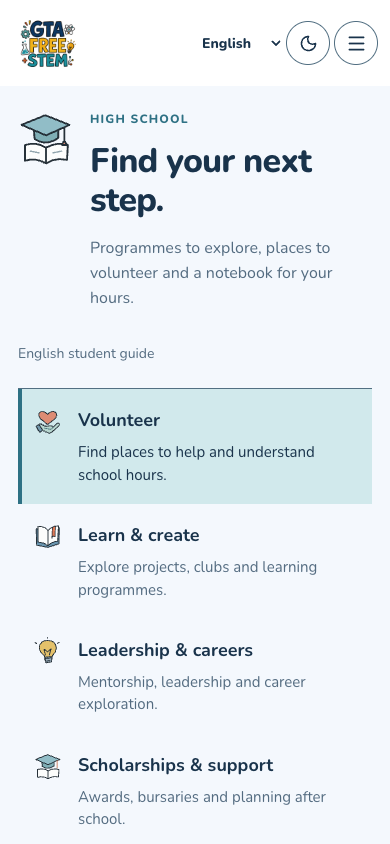
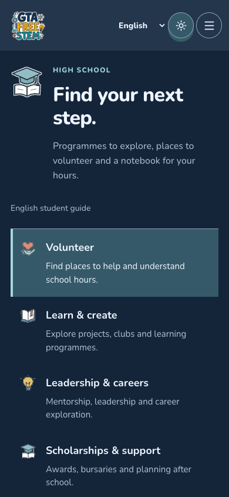
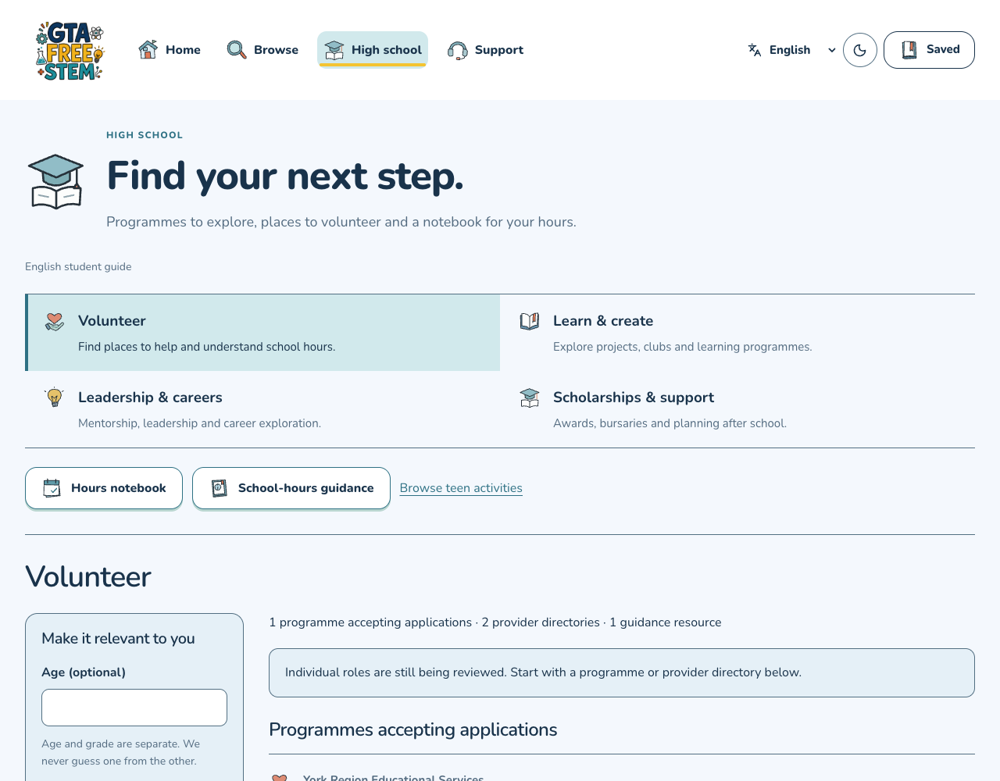
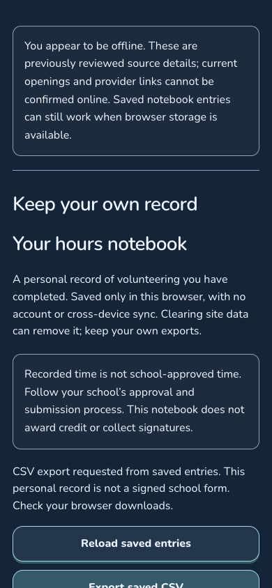

# High School student guide — October 30, 2026

Actual production-export screenshots, source `5a44d28bd35c794f6f25dff9d292a056096fddae`. These are local browser captures, not physical-device or public-host proof. [Image hashes and scope](capture-receipt.json).

| Student guide | Dark mode |
| --- | --- |
|  |  |

Choose Volunteer, Learn & create, Leadership & careers, or Scholarships & support. Age and grade are separate. Source details distinguish programmes, directories and guidance from individual roles, and explain costs, application timing and eligibility.

This first reviewed collection contains nine records: **zero confirmed individual volunteer roles**, one evidenced free programme intake, two directories, and other programmes or resources with their stated restrictions. It is a starting collection, not comprehensive GTA coverage. Unknown application dates or costs remain unknown. A programme or directory is not a guaranteed place or shift.

The English student guide and hours notebook are labelled as such. Curated facts are authored summaries, not verbatim provider descriptions. Ordinary event pages retain their full original descriptions.

## Hours notebook

The screenshot uses a clearly fictional test entry. Record actual minutes, edit or delete entries, and export a personal CSV. Data stays in this browser's local database, without an account or cloud sync. Saving a record does not approve school hours. Confirm activities with your school before starting and use its required forms.

Checks covered persistence, two-tab conflicting edits, failure states that retain drafts, latest-record CSV export, and offline editing/export in an already-loaded session followed by reconnect and reload. This does not promise first-time offline installation. Failed or unsupported storage is reported rather than shown as a successful save.

## Checked scope

- Production build, TypeScript, 21 High School test groups, 7,872 sitemap pages and 7,821 full provider descriptions passed.
- Light and dark student-guide pages had zero automated WCAG A/AA violations in the checked scope. This is not a whole-product accessibility certification.
- Cold artwork loading, reduced-motion preference, no browser page errors, and 200% equivalent reflow passed. Reflow used a 640×500 CSS viewport with DPR 2; native browser-menu zoom and a physical phone keyboard were not tested.
- Existing age-based activities remain available through **Teen activities**; legacy links, filter clearing and reload retain that view.
- The existing native opportunity feed is unchanged. These web features do not imply native High School availability.

[Source research and remaining coverage work](../../research/high-school/recon.md).
