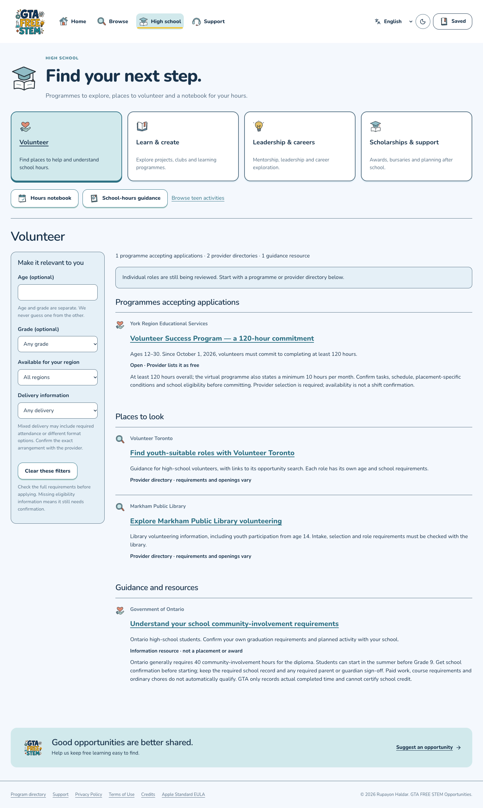

# High School pathway polish — October 30

Actual local production-export captures at application source `f264eacd0a435e392acc3bce8338e1e9a252e7fd`. Candidate `cfd8d0a42baae4db8d3ef4b8ff1c634669901195` changes only a QA assertion; its four product files are identical. [Capture hashes and check scope](verification-receipt.json). These are browser viewport checks, not physical-phone proof.

| Phone — light | Phone — dark |
| --- | --- |
|  |  |

The pathways use four columns on wide screens, two on tablets and one on phones. The redundant English guide banner is absent on English UI; another selected interface language receives an accurate, smaller untranslated-content notice. The English content retains its correct language semantics.

Explicit age/grade mismatches now exclude provider directories as well as programmes. Markham's 14+ directory is excluded at age 12, included at 14 and restored with no age filter. Unknown eligibility stays clearly unconfirmed.

Production build, TypeScript, 21 High School tests, 7,872 canonical pages and 7,821 full original provider descriptions passed. Eight 320/390/768/1440 light/dark layouts had the expected columns, equal heights, no measured overlap or overflow, and loaded artwork. Checked light/dark pages had zero automated accessibility violations; keyboard focus, language notice and effective reduced-motion checks passed. An initial QA-only duration-string assertion failed and was corrected to check actual disabled transition/movement; product bytes did not change.

This polish does not add youth-role ingestion or special-needs/support filtering. Those remain required work. The native feed bytes are unchanged. [Initial guide, notebook scope and coverage limits](../README.md).
