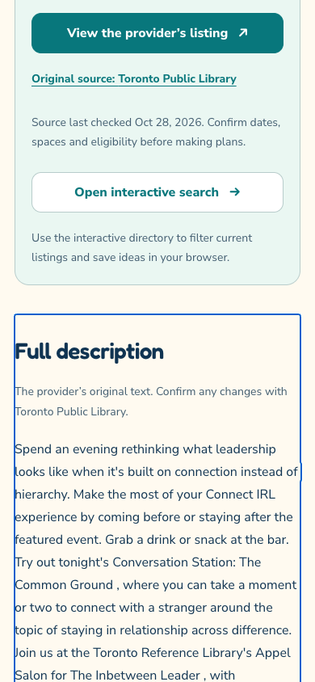

# Website screenshots and release checks

These images were captured from the public website on October 27, 2026, after deploying [website release d98c5d3](https://github.com/rupayon123/gta-free-stem-opportunities/commit/d98c5d3a4e4785ae40efe4e06824af8d9ed14fda).

| Screenshot | What it shows | Browser viewport |
| --- | --- | --- |
| [Home](web-home-live-2026-10-27.png) | Original GTA logo, science icons, search and visible city/age/category filters | 1440 × 1000 |
| [Map](web-browse-live-2026-10-27.png) | The default activity view, grouped location markers and the List switch | 1440 × 1000 |
| [3D neighbourhood](web-3d-live-2026-10-27.png) | Real building heights and the 2D/3D/All locations controls | 1440 × 1000 |
| [Dark 3D](web-3d-dark-live-2026-10-27.png) | 3D buildings after a live theme switch | 1440 × 1000 |
| [Mobile 3D](web-3d-mobile-live-2026-10-27.png) | Narrow-screen map and touch controls | 390 × 844 |
| [List](web-list-live-2026-10-27.png) | The same activities and filters presented as cards | 1440 × 1000 |
| [Mobile](web-mobile-live-2026-10-27.png) | Compact branding and the search/filter form on a narrow screen | 390 × 1000 |

Capture method: headless Google Chrome with reduced motion enabled. Images are unretouched browser captures of https://gta-free-stem.pages.dev/ and its activity directory. [Machine-readable capture receipt](web-capture-receipt.json) records URLs, sizes, time and the deployed source commit. These screenshots demonstrate the website; native app release checks are tracked in their respective repositories.

## Checks for this release

Before pushing the application update, TypeScript, the full website QA suite, production build, dependency audit and all 7,810 sitemap/canonical-page checks passed. Browser checks covered phone, small phone, tablet and desktop layouts; whole-logo click/keyboard pause and resume with a jiggle, upright icons at five orbit positions and reduced motion; dark mode and Urdu right-to-left layout; typo search; Map-first, real 3D building rendering on desktop and phone in light/dark mode, 2D/3D/All locations controls and the List switch; saved activities surviving reload; directory/detail links; rapid query changes; and the List fallback when map tiles are unavailable. The production dependency audit reported zero vulnerabilities.

Public-site checks verified the deployed release and the unchanged 1,875-record native feed, and captured the real map and list views. Counts are a snapshot, not a promise of registration availability. The original provider confirms schedules, spaces and registration.

The older `home.png`, `search.png`, `high-school.png`, and `profile.png` files remain as a September 11, 2026 archive from the former Vercel address. Use the dated October 27 images above for the current presentation.

## Full original descriptions

Captured from the live Cloudflare site on October 28, 2026 (October 29 UTC), source `c5a18ce729cfa1b8344cb2761406d87d6547ae4c`. These unretouched 390×844 phone captures show the directory’s **Read full description** link and its destination. The visible focus outline identifies the keyboard navigation target. The other provider link remains available for registration and changes.

| Open the complete text | Read the provider’s description |
|---|---|
|  |  |

[Capture and publication receipt](2026-10-28-full-descriptions/capture-receipt.json). The published build verified exact original text on all 7,721 accepted event pages; counts are a dated snapshot. Live checks on both public hosts verified the full 4,438-character example, its ending, phone and desktop overflow, keyboard navigation and fragment focus. This addition does not claim full-description translations or new native app releases.
